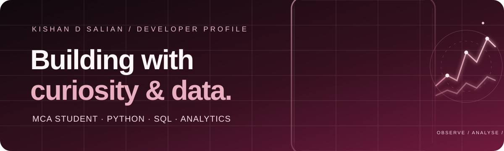

 

---

<table>
<tr>
<td width="66%" valign="middle">

</td>
<td width="34%" align="center" valign="middle">

</td>
</tr>
</table>

## 02 / The learning journey

## 03 / Toolkit

## 04 / Selected work

<table>
<tr>
<td width="50%" valign="top">

### Air Canvas
A real-time virtual drawing application controlled through hand gestures. Includes colour selection, erasing, saving drawings and a gallery for managing saved artwork.

**Stack:** Python · OpenCV · MediaPipe · NumPy · SQLite

[Explore repository →](https://github.com/saliankishan/Air-Canvas)

</td>
<td width="50%" valign="top">

### Weather Dashboard
A Flask-based weather application with current conditions, a five-day forecast, map, city comparison and searchable history.

**Stack:** Python · Flask · SQLite · OpenWeather API

[Explore repository →](https://github.com/saliankishan/Weather-Dashboard)

</td>
</tr>
<tr>
<td width="50%" valign="top">

### College Helpdesk Chatbot
A college query assistant with an admin panel to manage intents and responses, login functionality and analytics.

**Stack:** Python · Flask · SQLite · NLTK · Scikit-learn · HTML · CSS · JavaScript

[Explore repository →](https://github.com/saliankishan/college-chatbot)

</td>
<td width="50%" valign="top">

### Hunt the Wumpus
A browser-based Wumpus World adventure. Explore caves, interpret clues, avoid hazards, collect gold and hunt the Wumpus.

**Stack:** React · TypeScript · Vite · Tailwind CSS

[Play the game →](https://saliankishan.github.io/wumpus-world-game/) · [Source code →](https://github.com/saliankishan/wumpus-world-game)

</td>
</tr>
<tr>
<td width="50%" valign="top">

### Vijaya Food Fest
A college food-festival website project.

[Explore repository →](https://github.com/saliankishan/Vijaya-Food-Fest)

</td>
<td width="50%" valign="top">

### Retirement Fund Estimation
Current research project exploring retirement fund estimation using predictive analytics and a synthetic financial dataset.

**Focus:** Python · Data Analysis · Predictive Analytics

</td>
</tr>
</table>

## 05 / Recognition & community

<table>
<tr>
<td align="center" width="33%">

### 🥇
**1st Prize**

Cyber Quest

NITTE

</td>
<td align="center" width="33%">

### 🥈
**2nd Prize**

Debugging Competition

Mahaveer College

</td>
<td align="center" width="33%">

### 🤝
**2 years**

NSS Volunteer

Community service

</td>
</tr>
</table>

## 06 / Currently exploring

- Advanced SQL, querying and database concepts
- Python for data analysis with Pandas
- Exploratory data analysis and visualization
- Statistics and predictive analytics
- Foundations for a future in data engineering

## 07 / GitHub activity

---

