  
  
  

**MCA Student · MIT, Manipal · Aspiring Data Analyst**

---

## Learning path

## Skills & tools

## Selected projects

<table>
<tr>
<td width="50%" valign="top">

### Air Canvas
A hand-gesture-controlled drawing application with colour selection, erasing, saving drawings and a gallery for saved artwork.

**Python · OpenCV · MediaPipe · NumPy · SQLite**

[View project ↗](https://github.com/saliankishan/Air-Canvas)

</td>
<td width="50%" valign="top">

### Weather Dashboard
A Flask weather application featuring current conditions, a five-day forecast, a map, city comparison and searchable history.

**Python · Flask · SQLite · OpenWeather API**

[View project ↗](https://github.com/saliankishan/Weather-Dashboard)

</td>
</tr>
<tr>
<td width="50%" valign="top">

### College Helpdesk Chatbot
A college query assistant with login functionality, an admin panel for managing intents and responses, and basic analytics.

**Python · Flask · SQLite · NLTK · Scikit-learn · JavaScript**

[View project ↗](https://github.com/saliankishan/college-chatbot)

</td>
<td width="50%" valign="top">

### Hunt the Wumpus
A browser-based Wumpus World game. Explore caves, interpret clues, avoid hazards, collect gold and hunt the Wumpus.

**React · TypeScript · Vite · Tailwind CSS**

[Play game ↗](https://saliankishan.github.io/wumpus-world-game/) · [Source ↗](https://github.com/saliankishan/wumpus-world-game)

</td>
</tr>
<tr>
<td width="50%" valign="top">

### Retirement Fund Estimation
An ongoing MCA research project exploring retirement fund estimation using predictive analytics and a synthetic financial dataset.

**Python · Data Analysis · Predictive Analytics**

</td>
<td width="50%" valign="top">

### Vijaya Food Fest
A college food-festival website project.

[View project ↗](https://github.com/saliankishan/Vijaya-Food-Fest)

</td>
</tr>
</table>

## Recognition & community

| 🥇 First Prize | 🥈 Second Prize | 🤝 Community |
|:---:|:---:|:---:|
| Cyber Quest | Debugging Competition | NSS Volunteer |
| NITTE | Mahaveer College | 2 years |

## Currently focused on

- Writing better SQL queries and strengthening relational database concepts.
- Using Python and Pandas for data cleaning, exploration and analysis.
- Building foundations in statistics and predictive modelling.
- Understanding databases, data pipelines and the principles of Data Engineering.

## GitHub activity

---

